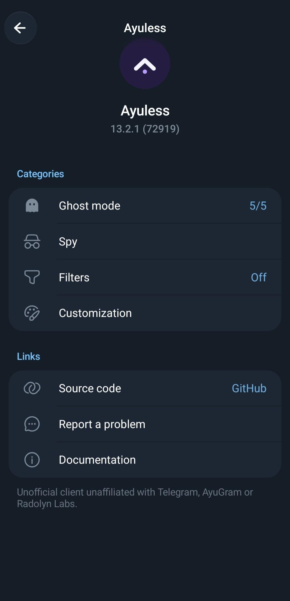
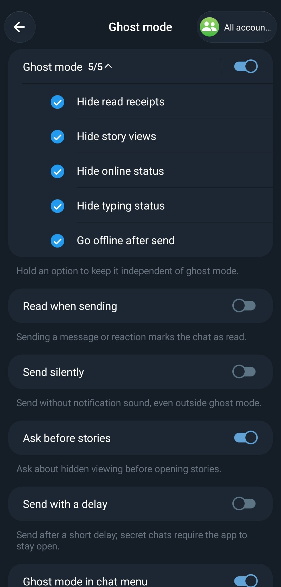
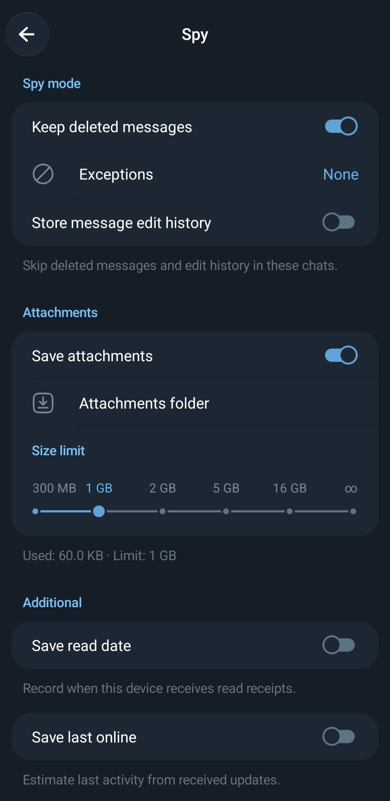

<p align="center">
  
</p>

# Ayuless — Telegram client for Android

**An open-source unofficial Telegram messenger with ghost mode, anti-delete, edit history, message filters and UnifiedPush. No Google Play Services or Firebase.**

**Неофициальный Telegram-клиент для Android с режимом призрака, сохранением удалённых сообщений, историей правок, фильтрами и UnifiedPush. Без Google Play Services и Firebase.**

[](https://github.com/SU4G3/Ayuless/releases/latest)
[](LICENSE)
[](https://github.com/SU4G3/Ayuless/releases/latest)

**[Download APK / Скачать APK](https://github.com/SU4G3/Ayuless/releases/latest)** · [Telegram](https://t.me/ayulessapp) · [Changelog](docs/CHANGELOG.md) · [FAQ](docs/FAQ.md) · [Report a bug](https://github.com/SU4G3/Ayuless/issues/new?template=bug_report.yml)

[Русский](#русский) · [English](#english)

## Screenshots / Скриншоты

<p>
  
  
  
</p>

[Customization / Оформление](docs/images/customization.jpg)

## Русский

Ayuless — бесплатный Telegram-клиент с открытым исходным кодом для Android 6.0 и новее. Основан на официальных исходниках Telegram; идеи некоторых возможностей вдохновлены AyuGram. Ayuless не связан с Telegram, AyuGram или Radolyn Labs.

### Скачать и установить

**[Скачать последнюю версию Ayuless](https://github.com/SU4G3/Ayuless/releases/latest)** · [APK 1.0.0](https://github.com/SU4G3/Ayuless/releases/download/v1.0.0/Ayuless-v1.0.0.apk)

Текущий релиз — **Ayuless 1.0.0**. В настройках Android отображается базовая версия Telegram **13.2.1 (72919)**. Один APK включает arm64-v8a, armeabi-v7a, x86 и x86_64. ID приложения: `org.ayuless.messenger`; можно установить рядом с официальным Telegram.

> **Переход с alpha/test APK:** в 1.0.0 используется новый личный ключ подписи. Перед удалением старой версии экспортируйте локальную базу Ayuless и сохранённые вложения. Секретные чаты при удалении приложения потеряются; облачные чаты доступны после входа. Обновление поверх старой подписи не установится. [Подпись и проверка APK](docs/RELEASE-SIGNING.md).

### Возможности

- **Режим призрака:** управление отправкой статуса «онлайн», прочтений, набора текста и просмотров историй; общие и отдельные профили аккаунтов.
- **Анти-удаление и история правок:** локальное сохранение полученных сообщений, вложений и прошлых редакций. Неполученное содержимое восстановить нельзя.
- **Отложенная отправка:** задержка сообщений, пересылок и ответов на истории; для секретных чатов — локальная задержка.
- **Фильтры сообщений:** ключевые слова, регулярные выражения и скрытие заблокированных пользователей, включая превью и уведомления.
- **Инструменты чата:** просмотр сохранённых сообщений, экспорт переписки в HTML/JSON, очистка и действие «Прочитать».
- **UnifiedPush:** уведомления через ntfy и другие совместимые дистрибьюторы. Выбор: **Настройки → Ayuless → Уведомления**. Без дистрибьютора используется фоновое соединение.
- **Оформление и карты:** эмодзи Noto со всеми сочетаниями тонов рук; MapLibre с обычной картой, спутником и гибридом.
- **Локальная база:** экспорт, импорт и очистка; дополнительные настройки сохранения для секретных чатов, TTL и медиа «посмотреть один раз».

Настройки находятся в **Настройки → Ayuless**. Анти-удаление, сохранение вложений, скрытие спонсорских сообщений и работа в фоне включены по умолчанию; остальные возможности настраиваются отдельно. Ранее сохранённые значения не сбрасываются при обновлении.

### Открытость и состояние проекта

Код — **GPL-3.0-or-later**. Нативные библиотеки, WidgetJS и QuickJS релиза 1.0.0 собираются из закреплённых исходников; эмодзи Noto и необходимые известные лицензии сохранены. Для работы требуется аккаунт и несвободные серверы Telegram. Аудит отдельных унаследованных ресурсов продолжается; не обещаем отсутствие любых бинарных данных или полную анонимность.

Полная сборка и проверки APK прошли, владелец подтвердил работу на телефоне. Это не исчерпывающая проверка всех функций. Две чистые APK-сборки на воспроизводимость не сравнивались.

**В официальном каталоге F-Droid приложения пока нет.** Первая заявка закрыта: требуется история сопровождения проекта и соблюдение шаблона MR. Релизы распространяются через GitHub. [Статус F-Droid и FAQ](docs/FAQ.md#f-droid).

[Что нового](docs/CHANGELOG.md) · [Планы](docs/ROADMAP.md) · [Исходники 1.0.0](https://github.com/SU4G3/Ayuless/tree/v1.0.0) · [Отчёт о сборке](https://github.com/SU4G3/Ayuless/blob/v1.0.0/docs/fdroid/VALIDATION-2026-11-17.md)

## English

Ayuless is a free, open-source Telegram client for Android 6.0 and newer. It is based on official Telegram sources, with some feature ideas inspired by AyuGram. It is not affiliated with Telegram, AyuGram or Radolyn Labs.

### Download and install

**[Download the latest Ayuless APK](https://github.com/SU4G3/Ayuless/releases/latest)** · [APK 1.0.0](https://github.com/SU4G3/Ayuless/releases/download/v1.0.0/Ayuless-v1.0.0.apk)

Current release: **Ayuless 1.0.0**. Android displays Telegram base version **13.2.1 (72919)**. The universal APK includes arm64-v8a, armeabi-v7a, x86 and x86_64. Application ID: `org.ayuless.messenger`; it can coexist with official Telegram.

> **Upgrading from alpha/test APKs:** 1.0.0 uses a new private signing key. Export your local Ayuless database and saved attachments before uninstalling the old version. Secret chats are lost on uninstall; cloud chats remain available after signing in. The new APK cannot update the old signature in place. [Signing and APK verification](docs/RELEASE-SIGNING.md).

### Features

- **Ghost mode:** control online status, read receipts, typing and story views, with global and per-account profiles.
- **Anti-delete and edit history:** locally retain received messages, attachments and previous edits. Content never received by the device cannot be recovered.
- **Delayed send:** delay messages, forwards and story replies; secret chats use a local delay.
- **Message filters:** keywords, regular expressions and blocked-user filtering, including chat previews and notifications.
- **Chat tools:** retained-message browser, HTML/JSON chat export, cleanup and a mark-as-read action.
- **UnifiedPush:** notifications through ntfy and other compatible distributors. Choose one in **Settings → Ayuless → Notifications**. Without a distributor, the app uses a background connection.
- **Customization and maps:** Noto emoji with all handshake skin-tone combinations; MapLibre maps with satellite and hybrid views.
- **Local database:** export, import and cleanup, plus optional retention settings for secret chats, TTL and view-once media.

Controls live in **Settings → Ayuless**. Anti-delete, saved attachments, sponsored-message hiding and background work default on; other features are configured separately. Existing saved choices are preserved across updates.

### Open source and project status

Code is **GPL-3.0-or-later**. The 1.0.0 release builds native libraries, WidgetJS and QuickJS from pinned sources and retains Noto artwork and known licence notices. A Telegram account and Telegram's proprietary service are required. Individual inherited-resource provenance remains under review; we do not claim the absence of all binary data or full anonymity.

The full build and APK checks pass, and the owner reported the APK works on a phone. This is not exhaustive feature testing. Two clean final APK builds have not been compared for reproducibility.

**Ayuless is not in the official F-Droid catalog.** The first request was closed over the project's maintenance history and MR template requirements. Releases are distributed through GitHub. [F-Droid status and FAQ](docs/FAQ.md#f-droid).

[Changelog](docs/CHANGELOG.md) · [Roadmap](docs/ROADMAP.md) · [1.0.0 source](https://github.com/SU4G3/Ayuless/tree/v1.0.0) · [Build report](https://github.com/SU4G3/Ayuless/blob/v1.0.0/docs/fdroid/VALIDATION-2026-11-17.md)

## Build from source / Сборка из исходников

To build the published release rather than the development branch, check out its tag:

```sh
git clone --branch v1.0.0 --depth 1 --recursive --shallow-submodules https://github.com/SU4G3/Ayuless.git
cd Ayuless
```

The validated environment uses JDK 21, Android SDK 36, NDK 27.2.12479018 and SDK CMake 3.22.1. Native build tools and pinned Rust/Node inputs are described in the [release's native-build guide](https://github.com/SU4G3/Ayuless/blob/v1.0.0/docs/NATIVE.md); the complete [F-Droid recipe](https://github.com/SU4G3/Ayuless/blob/v1.0.0/docs/fdroid/org.ayuless.messenger.yml) records provisioning and source-build steps.

Build output: `TMessagesProj_App/build/outputs/apk/afat/release/app.apk`. Local Gradle test signing is separate from the private public-release key; see [release signing](docs/RELEASE-SIGNING.md). Never publish the private key or session data.

## Contributing and credits / Участие и благодарности

[Contribution rules](CONTRIBUTING.md) · [Translations / Переводы](docs/TRANSLATING.md) · [Bug reports](https://github.com/SU4G3/Ayuless/issues) · [Security reports](SECURITY.md)

Help translate Ayuless on [Crowdin](https://crowdin.com/project/ayuless). Помочь с переводом Ayuless можно на [Crowdin](https://crowdin.com/project/ayuless).

Thanks to [Telegram](https://github.com/DrKLO/Telegram) for the upstream client, [AyuGram / Radolyn Labs](https://github.com/AyuGram) for feature inspiration, and [exteraless](https://github.com/exteraless) for the name idea. AyuGram-derived implementation code was removed and independently reimplemented from a written specification; earlier Git history still contains that port. [Clean-room notes](docs/CLEANROOM-REMOVED.md).

Ayuless: [GPL-3.0-or-later](LICENSE). Telegram upstream: [GPL-2.0-or-later](LICENSE.GPL-2.0). Solar icons by 480 Design and R4IN80W: [CC BY 4.0](https://creativecommons.org/licenses/by/4.0/). [Credits](docs/CREDITS.md) · [Release resource audit](https://github.com/SU4G3/Ayuless/blob/v1.0.0/docs/LICENSE-AUDIT.md).
