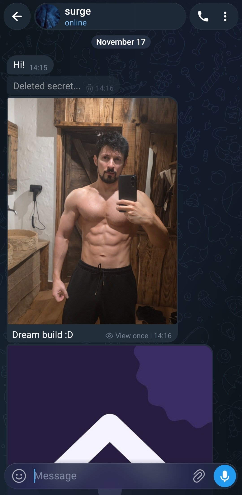
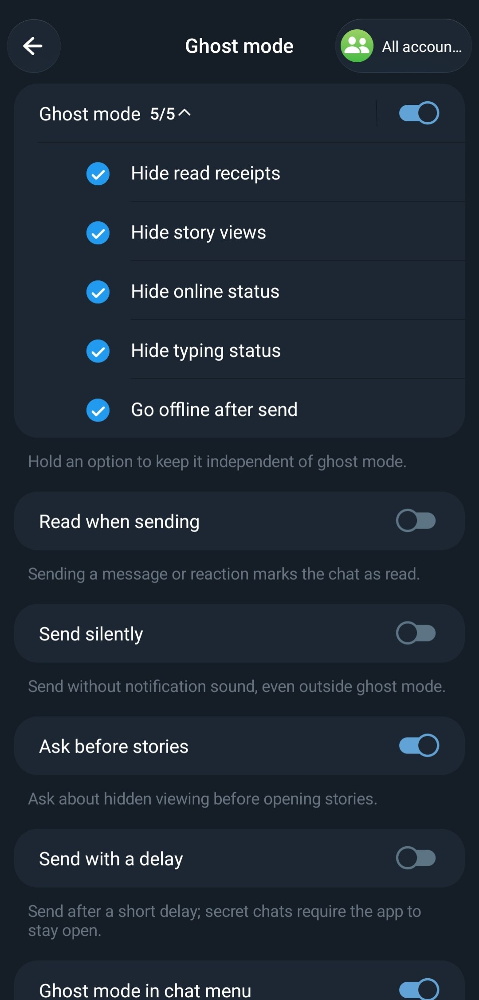

# New app: Ayuless

Current submission status (2026-11-17): [F-Droid packaging request #4819](https://gitlab.com/fdroid/rfp/-/work_items/4819) is submitted and verified. [Metadata MR !57850](https://gitlab.com/fdroid/fdroiddata/-/merge_requests/57850) is submitted and linked to that request. The MR was closed over template and maintenance-history requirements; resubmission is deferred. Ayuless 1.0.0 is published on GitHub, and its application source is now integrated into main through GitHub PR #62. Earlier submission/CI-pending statements describe historical preparation.

## Abstract for new app inclusion

Ayuless is an unofficial, GPL-3.0-or-later Telegram Android client. It adds
configurable ghost controls, local retention of deleted messages and edit history,
chat filters, customization, and UnifiedPush notifications via an installed
distributor such as ntfy. The app requires a Telegram account and Telegram's
proprietary service. Retention and ghost features are user-controlled; optional
sponsored messages are disclosed in metadata.

The project owner requested this submission. This fork combines its retention
and privacy controls with a de-Googled build and UnifiedPush. Google Play Services,
Firebase and Huawei push are not dependencies of this build.

- Source: https://github.com/SU4G3/Ayuless
- Release tag: https://github.com/SU4G3/Ayuless/releases/tag/fdroid-13.2.1-72919
- Exact source: `afadbaf8fe909ff11e2b2f5086c153ac5dd28c46`
- Application ID: `org.ayuless.messenger`
- Version: `13.2.1` / `72919`; min SDK 23, target SDK 36.
- Store metadata: https://github.com/SU4G3/Ayuless/tree/fdroid-13.2.1-72919/fastlane/metadata/android
- Issue tracker: https://github.com/SU4G3/Ayuless/issues




## Build and validation

The recipe completed in rootless Podman using the official
`registry.gitlab.com/fdroid/fdroidserver:buildserver-trixie` image, digest
`sha256:1ea8bef1820bff06c2974e31b4fc4c79c364cd24231b86e71fa4b926797e0dac`,
with fdroidserver 2.4.5, JDK 21 and NDK 27.2.12479018:

```sh
fdroid build --on-server --test --scan-binary --verbose org.ayuless.messenger:72919
```

This uses the internal CI-container mode; a Vagrant `--server` VM is not claimed.
Preparation, source scan, all 64 native archives, source-built esbuild and
WidgetJS/QuickJS, release assembly, APK non-free-class scan and signing-block scan
pass. The build finishes with `1 build succeeded`. The enabled submission metadata
also passes `fdroid readmeta` and `fdroid lint`.

- Unsigned APK SHA-256: `c6c66c27a41a5fddf0b24714a35f21d45596a94204f193a641e42721bc0c8b9c`.
- APK size: about 97.6 MiB, all four ABIs. The initial recipe retains the tested
  universal afat variant; ABI splitting is a possible follow-up if requested.
- All 3,606 Noto emoji records, 36 handshake skin-tone combinations and 47
  packaged licence files were checked against the final APK.
- The owner reported that the final separately signed test copy works on a phone.
  This is general feedback, not a claim of an exhaustive test matrix.
- Build report: https://github.com/SU4G3/Ayuless/blob/c1be3c2e/docs/fdroid/VALIDATION-2026-11-17.md

## Source and review notes

Native libraries build from pinned source submodules, not GitHub binary caches.
Cargo crates are vendored during preparation. A narrow helper removes only
hash-verified unused binary test/fuzz fixtures and their file checksum entries;
remaining registry package/file checksums are retained. Source scan exceptions
cover nine little-endian float arrays consumed by DiamondRenderer, not executable
code. WAMR uses pinned local SIMDe; a separate four-ABI check with network disabled
passed. Complete APK network isolation was not tested.

Apple-derived emoji have been replaced with Noto. Pinned SVG inputs, mappings,
generation tools and applicable Apache/flag notices are retained. Standard
Roboto/Mono/Merriweather fonts retain their applicable Apache/OFL notices.
Inherited gram/num fonts, OCR, PhoneFormats/shapes data and all 366 compared model,
animation and sound files match Forkgram commit
`26dbf897e92ed64b5b6033df6484e05e427fa4d7` from its F-Droid recipe.
This is provenance evidence, not an assertion of independent clearance of each
third-party asset. The original RMPhoneFormat README describes Apple SDK data;
model training inputs and some individual asset authorship are not established.
No incompatible terms were identified for those inherited files in this review.

- Resource evidence: https://github.com/SU4G3/Ayuless/blob/438049cb/docs/fdroid/ASSET-REVIEW-2026-11-17.md
- Source inventory/audit: https://github.com/SU4G3/Ayuless/blob/438049cb/docs/LICENSE-AUDIT.md

The owner-selected public Telegram API ID 4, matching hash/fingerprint and
LoginSpoof are present in the source profile; please include this in review.
NonFreeNet (Telegram) and Ads (optional sponsored messages) are declared.

Reproducible upstream signing is not enabled: two clean final APKs have not been
compared, and the existing upstream test key is public. F-Droid should sign its
own build. AutoUpdateMode is None for the first inclusion review; the restricted
`fdroid-<versionName>-<versionCode>` tag check is configured.

## Checklist

- [x] The fork owner requested inclusion.
- [x] Public source, licence, issue tracker and tagged release commit are available.
- [x] English/Russian fastlane metadata and changelog, icon and five English screenshots are upstream.
- [x] Only this app's YAML metadata belongs in the fdroiddata MR.
- [x] YAML uses LF and the full immutable source commit; no disabled build entry.
- [x] Local readmeta/lint and official-image recipe build/scans pass.
- [ ] F-Droid maintainer policy/source review; contextual questions disclosed above.
- [ ] GitLab fork pipeline and any resulting findings need verification after push.

/label ~"New App"
